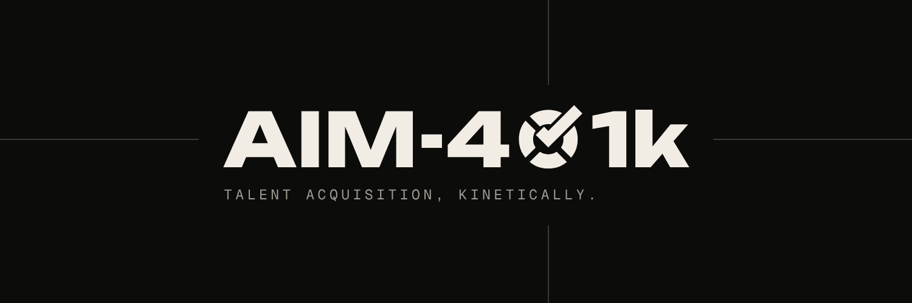

<p align="center">
  
</p>

<p align="center">
  <b>A Firefox extension that fills out job applications for you and tracks every one,<br/>and only interrupts you when a person is genuinely needed.</b>
</p>

<p align="center">
  <a href="#install">Install</a> ·
  <a href="#first-run">First run</a> ·
  <a href="#everyday-use">Everyday use</a> ·
  <a href="#privacy">Privacy</a> ·
  <a href="#ai-providers-optional">AI providers</a> ·
  <a href="#troubleshooting">Troubleshooting</a> ·
  <a href="#for-developers">For developers</a>
</p>

---

## What it does

Paste in links to job postings. AIM-401k opens each one in a background tab, finds the application form, and fills it in from your profile and resume. It handles multi-page forms, work-history sections, uploads and date pickers. It keeps a tracker of everything it touched, and can update statuses from your inbox.

It stops and asks you when it reaches something it shouldn't decide alone:

- a question it doesn't have an answer for,
- a certification, consent box or signature,
- a CAPTCHA or a sign-in page,
- a finished application, so you can review it before it's submitted.

When that happens, a small box appears in the corner of whatever tab you're on. Answer it there, or jump to the tab, and AIM-401k carries on. Answers you give are saved, so the same question doesn't come back.

**Your data stays on your computer.** There are no AIM-401k servers, accounts or analytics. Your profile, resume and tracker live in Firefox's own extension storage. AI is optional and bring-your-own.

> [!NOTE]
> The interface is styled as a tongue-in-cheek defense-tech HUD ("Engage this tab", "War Room"). Turn on **Plain mode** in the popup or in Settings and every label switches to ordinary wording. This README uses the plain names.
>
> The themed names follow one fixed glossary, used the same way in every view: **Target** = a job posting, **Engaged** = being filled in, **Hold** = waiting on you, **Release** = submit, **Splash** = submitted, **Contact** = a recruiter replied, **Secured** = an offer, **Lost** = closed.

## Install

**You need:** Firefox 140 or newer on desktop, plus [Node.js](https://nodejs.org) 20+ to build the extension.

1. **Get the code and build it.**

   ```bash
   git clone https://github.com/AaronDoubert/SLOP.git aim-401k
   cd aim-401k
   corepack enable        # provides the pinned pnpm version
   pnpm install
   pnpm package           # creates release/aim-401k-<version>.zip
   ```

2. **Load it into Firefox.**
   1. Go to `about:debugging#/runtime/this-firefox`.
   2. Click **Load Temporary Add-on…**
   3. Pick the zip from `release/` (or `dist/manifest.json`).

3. **Pin it.** Click the puzzle-piece icon in the toolbar and pin AIM-401k so its icon is always visible.

> [!IMPORTANT]
> A temporary add-on is removed when Firefox restarts, and its data goes with it. Before you restart, use **Settings → Backup → Export everything**, then import the file again afterwards. To install permanently, see [docs/FIREFOX.md](docs/FIREFOX.md). It covers signing the add-on yourself for free, or using Firefox Developer Edition.

## First run

A setup wizard opens as soon as the extension is installed. You can reopen it any time from the popup or from **Settings → Run setup wizard**. It takes a few minutes and saves typing on every application afterwards.

1. **Resume.** Drop in a PDF, Word (.docx), plain text or [JSON Resume](https://jsonresume.org) file. It's read on your computer and never uploaded. AIM-401k fills in your contact details and links, every job (title, company, location, dates, bullet points), your education, skills, certifications and summary. The file is also kept so it can be attached to applications.
2. **About you, and experience.** Check what was imported and fill any gaps. Jobs and schools are editable lists, so a form asking for "Work Experience 2" gets your second job.
3. **Eligibility and preferences.** Work authorization, sponsorship, citizenship, driver's license, clearance; target roles and locations, workplace type, salary; earliest start date or notice period. These answer the screening questions almost every application asks.
4. **Voluntary self-identification (EEO).** Optional. Defaults to "Decline to self-identify".
5. **AI helper.** Optional. Pick a provider and paste a key (see [AI providers](#ai-providers-optional)). With one connected, you can also click *Re-read my resume with AI* for a more accurate import.

## Everyday use

### Add jobs

- **From the toolbar popup:** on a job page, click **Autofill this tab** to fill it right there, or **Queue this tab** to add it to the list. You can also paste a batch of links into the popup and click **Queue**.
- **From the Tracker:** paste job posting or application links (any text containing links works) and click **Queue & start applying**. Use **Save for later** to track a job without applying yet.
- **From a spreadsheet:** **Tracker → Import spreadsheet** reads CSV/TSV, Excel (.xlsx), cells pasted from Google Sheets or Excel, or a published Google Sheet link. See [Spreadsheets](#spreadsheets).

Queued jobs open in background tabs, a few at a time. You can change how many in **Settings → Automation** or with the **Parallel tabs** control on the live dashboard.

### Answer when it asks

The box in the corner shows everything waiting on you. Type an answer, tick a consent, or sign. Finished applications wait for your review: open the tab and check the form, then **lift the guard** on the submit switch and **press and hold** it to send. Two deliberate actions (rather than one click) prevent accidental submissions.

### Keep track

| Where | What you get |
|---|---|
| **Popup** | The first four stages at a glance, items waiting on you, quick actions, and the Plain mode and Sound switches. |
| **Tracker** | Every application in a table or a board (Queued → Applying → Needs you → Applied → Interviewing → Offer, plus Closed). Search, notes, CSV and Excel export, spreadsheet import, and the inbox feed. Drag cards between columns to change status. Empty columns shrink to a thin rail. |
| **Live dashboard** | A full-screen view for when you step away: a table with one row per tab being filled (with a checklist of which fields are done, AI-drafted or waiting on you), the same stage totals as the Tracker, an activity log, and an away mode that collects questions and gives you a summary when you're back. A **Needs you** light in the header turns amber when anything is waiting; click it to jump between those jobs. **Map** shows an optional map of where your jobs are (US only, drawn offline). |
| **Settings** | Your profile, experience, saved answers, automation rules, AI helper, inbox, privacy and backup. |

On the page itself, fields are outlined as they're filled: **green** came from your profile or saved answers, **dashed amber** was drafted by AI and is worth reviewing, and **pulsing red** needs you.

### Inbox updates (optional)

Keep statuses current from your email:

- **Mail tab reader (on by default, no setup).** While Gmail or Outlook is open in a tab, AIM-401k reads the inbox *list* (sender, subject, preview) without opening or changing anything. It recognizes application confirmations, rejections, interview and assessment invitations, and offers, matches each to a tracked job by company and sender (including ATS senders like Greenhouse, Lever and Workday), and updates the status. Hiring emails it can't match show up in the Tracker's inbox feed for one-click assignment.
- **Gmail API (advanced).** Works with the tab closed. You bring your own Google OAuth client; **Settings → Inbox** walks you through it. It uses a read-only scope, keeps the token in memory only, and processes everything locally.
- **AI sorting** for emails the rules aren't sure about, using your AI provider, after Firefox asks for your consent.

### Spreadsheets

Already tracking applications in a sheet? Import it.

- Columns are matched automatically (company, role, link, status, date applied, location, notes, salary, contact). Each status value in your sheet is mapped too, and you can override any of it before importing.
- Rows you already track are updated rather than duplicated, and a status never moves backwards.
- Export back to `.xlsx` or CSV from the Tracker whenever you like.

## What's never automatic

- **Signatures, attestations and consent boxes** always come to you first. If you approve a consent with *always* ticked, the same wording is approved automatically next time. Signatures are never remembered unless you choose to.
- **CAPTCHAs and sign-ins** are always yours.
- **Final submit** is yours, unless you turn on *Submit automatically* in Settings. Even then, it won't auto-submit when a CAPTCHA is showing or when AI-drafted answers are on the page (unless the AI mode is set to `auto`).
- **Date of birth** always goes to you.

## Privacy

- Everything is stored in Firefox's extension storage on your computer. There's no AIM-401k server to send it to.
- **Settings → Privacy** shows exactly where data goes, lists everything stored with its size, and lets you export, clear your application history, forget AI keys, or erase everything.
- The **privacy guard** (on by default) strips your email, phone number and street address from anything sent to an AI provider.
- Firefox asks for your consent before any online AI provider is used. Local models (Ollama, LM Studio) don't need it.
- API keys are only read by the extension's background script and only sent to the provider you picked.

The full list of network endpoints the extension can contact is in [docs/FIREFOX.md](docs/FIREFOX.md).

## AI providers (optional)

Without AI, AIM-401k still fills everything your profile and saved answers cover, and asks you for the rest. With AI connected, it can draft answers to open-ended questions ("Why do you want to work here?") and read your resume more accurately.

| Provider | Sign in with | Cost | Get a key |
|---|---|---|---|
| Google Gemini | Google account | Free tier, rate-limited, no card | [aistudio.google.com/apikey](https://aistudio.google.com/apikey) |
| Groq | Google, GitHub or email | Free tier, rate-limited, no card | [console.groq.com/keys](https://console.groq.com/keys) |
| OpenRouter | Google, GitHub or email | `:free` models: 20/min, 50/day (1,000/day after a one-time $10 top-up) | [openrouter.ai/keys](https://openrouter.ai/keys) |
| GitHub Models | GitHub account | Free for prototyping, low daily limits | Fine-grained token with *Models: read* |
| Mistral | Email or Google, plus phone verification | Free "Experiment" plan; requests may be used for training | [console.mistral.ai](https://console.mistral.ai/api-keys) |
| Ollama | No account | Free and private, runs on your computer | Start Ollama with `OLLAMA_ORIGINS=moz-extension://*` |
| Anthropic Claude | Email or Google | Paid | [console.anthropic.com](https://console.anthropic.com/settings/keys) |
| Other | — | — | Any OpenAI-compatible `/chat/completions` server |

Free-tier limits change often; *Test & load models* checks your key and lists the models it can use. On free tiers, providers may use your prompts to improve their models. Prompts include your profile and resume text, with contact details removed by the privacy guard.

The setup screen helps: it detects Ollama or LM Studio running on your computer and offers one-click setup, warns when a key doesn't look like it belongs to the provider you picked, explains errors in plain words (bad key, rate limit and when to retry, model not found), and shows how many requests you've made today against the free limits.

## Supported sites

The form engine is generic: it reads labels, ARIA attributes and autocomplete hints, so it works on most application forms. It has specific handling for **Greenhouse, Lever, Ashby, Workday, SmartRecruiters, iCIMS, Jobvite, Workable** and BambooHR-style flows, including forms embedded in an iframe on a company's careers page.

Workday and some others need an account per company. AIM-401k asks you to sign in, then continues.

**LinkedIn Easy Apply and Indeed are deliberately not supported.** Their terms prohibit automation, and accounts that use it get restricted.

## Troubleshooting

**Everything disappeared after I restarted Firefox.**
Temporary add-ons are removed on restart. Export a backup before restarting (**Settings → Backup**), or install permanently using [docs/FIREFOX.md](docs/FIREFOX.md).

**A job says "Stuck".**
It stopped making progress, usually on an unusual page. Open the tab and finish that step by hand, or retry it from the Tracker. Jobs whose tabs were closed are marked *Failed* and can be retried.

**Ollama doesn't connect.**
Ollama has to allow requests from extensions. Restart it with `OLLAMA_ORIGINS=moz-extension://*` set.

**It filled something wrong.**
Fix it on the page before you submit. To change what it uses next time, update your profile or add an answer in **Settings → Saved answers**; saved answers take priority over profile rules.

## For developers

```bash
pnpm install
pnpm build        # bundle into dist/
pnpm watch        # rebuild on change (then click Reload in about:debugging)
pnpm test         # unit and DOM tests (Vitest)
pnpm typecheck
pnpm package      # build and zip into release/
pnpm e2e          # end-to-end run in Chromium; needs Playwright installed
```

The manifest declares both `background.scripts` (used by Firefox) and `background.service_worker` (used by Chromium), so the same build runs in Chromium for the automated end-to-end tests.

### How it works

```
 tracker / popup ──addJobs──▶ background (queue runner; single source of truth in storage.local)
                                 │ opens an inactive tab per job (concurrency + max-open-tabs caps)
                                 ▼
                       content script in the job tab (all frames)
                         1. confirmation page?  → mark Applied, close tab
                         2. no form?            → click "Apply" / detect a sign-in wall
                         3. scan fields → resolve each:
                              section entry (Work Experience N) ▸ saved answer ▸ profile rule ▸ AI draft ▸ ask you
                         4. fill (React-safe events, file upload, custom dropdowns, dates in any format)
                         5. all filled → click Next … → final step:
                              autoSubmit off (default) → "Ready to review and submit"
                         reports needs ─▶ background ─▶ box on every tab + badge + notification
 you answer in the box ─▶ background saves the answer ─▶ content script fills that field and continues
```

- **Reliability.** State lives in `storage.local`, and every write goes through one serialized writer in the background. Each pass of the content script is idempotent and re-runs when the page changes. A step guard stops it from clicking Next forever, and a watchdog flags jobs that stop making progress. After a browser restart, in-flight jobs are re-queued.
- **Dates.** Native date pickers, typed formats (the `MM/DD/YYYY`-style hint is read from the placeholder or label), Month/Day/Year dropdowns, Workday-style split boxes, and read-only calendar inputs. Start dates come from your earliest start date or notice period, and a "Date" field next to a signature gets today's date.
- **Copy.** Every themed string has a plain variant in `src/shared/copy.ts` and `src/shared/copy/*.ts`. Internals keep plain names (`needs_you`, `submitted`, …).

### Project layout

```
brand/           logo, mark, profile pictures, X banner, brand rules
docs/            FIREFOX.md (signing, lint, network endpoints), NIGHT-PLAN.md (architecture notes)
scripts/         build, package, and the Playwright e2e run (scripts/e2e.d/ has the feature suites)
src/core/        pure, unit-tested logic: matching, dates, resume parsing, email intel, spreadsheets, zip
src/content/     page scanner, filler, page detection, autopilot loop, the on-page box, mail tab reader
src/background/  store, queue and job events, live dashboard state, inbox, privacy, AI providers
src/ui/          setup wizard, popup, settings, tracker, live dashboard, AI setup, privacy panel
src/shared/      types, messages, defaults and migrations, providers, copy, inlined brand mark
static/          manifest, HTML, CSS and icons (copied into dist/)
test/            Vitest unit and DOM tests, plus fixtures for the e2e run
```

### Brand

The look follows the brand kit in [`brand/`](brand/README.md): the logo is always the supplied artwork; Geist for headlines and body; Geist Mono in caps with wide letter spacing for labels, stats and captions; near-black `#0C0C0B`, off-white `#F1EDE4` and grey `#A19D94`. The tokens live at the top of `static/styles.css`.

## Roadmap

- Per-site adapters for Workday's account flow and multi-page iCIMS.
- "Add another" automation for repeated work-experience sections.
- Job discovery: pull postings from saved searches into the queue.
- Follow-up reminders and a weekly summary.
